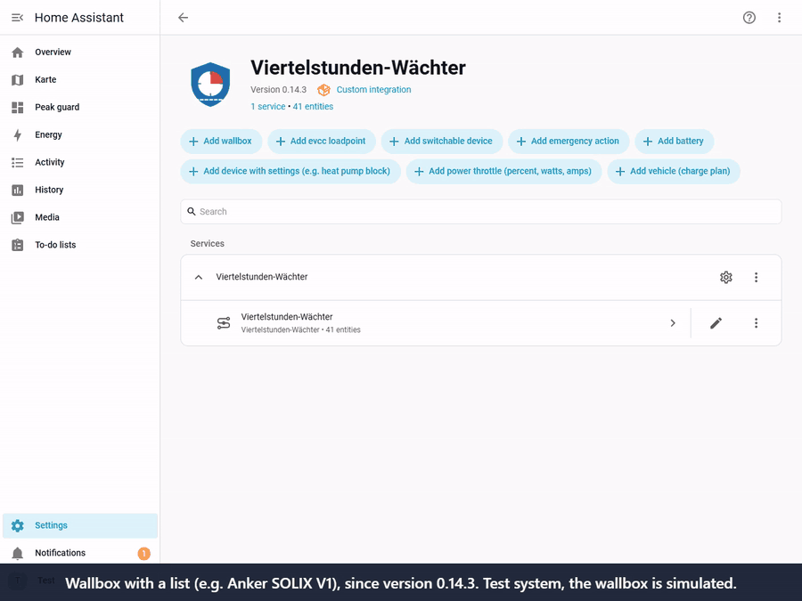
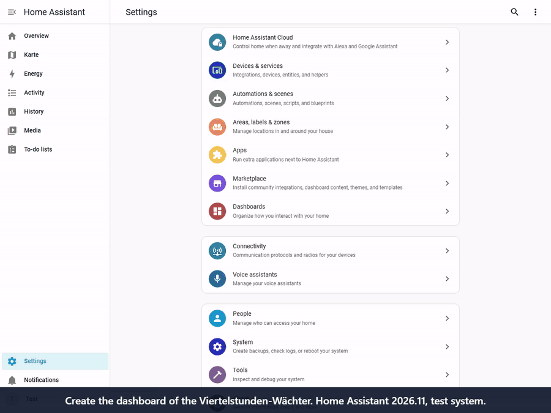

# FAQ (technical)

Questions users really asked, with a short answer. More in the [manual](MANUAL.md).
*Deutsch: [HAEUFIGE_FRAGEN.md](HAEUFIGE_FRAGEN.md)*

## Setting up

**Do I need solar panels?**
No. The guard only needs the grid import. Only the charge plan uses solar, and there it is optional.

**Which sensors do I need?**
1. **Grid import power** (required): in W or kW, with a new value every few seconds. A sensor that goes negative while exporting
   works as well.
2. **Grid import energy counter** (recommended): in Wh or kWh, counts only the import and keeps rising. It keeps the quarter hour
   right after a restart.

**I have no meter of my own, only the grid operator's smart meter.**
Two ways, see [manual, section 1](MANUAL.md):
- A meter in the distribution board, for example a Shelly with current clamps. The easiest start.
- The customer interface of the smart meter with a reading head. The grid operator hands out the key on request.

The grid operator's web portal is not enough: its values arrive the next day.

**Are values every 15 minutes or every hour enough?**
Not for controlling. The guard has to see the *running* quarter hour. A value older than 2 minutes counts as missing: the guard
does not act and shows *no data*. It still shows peaks and costs afterwards.

**My template sensor (e.g. from a Shelly 3EM Pro) is missing from the list.**
Since 0.13.3 any sensor can be chosen. The dialog checks the **unit** (W/kW or Wh/kWh), not the device class.

**How do I set up a battery with an adjustable minimum charge (from 0.15)?**
This works for any battery whose lower limit in percent can be set in Home Assistant (minimum SOC, discharge limit, reserve).
Example with a Victron: normally the minimum SOC is 30 %; to catch a peak the battery may deliver down to 15 %. At the device
*Battery*:

| Field | Entry |
|---|---|
| State of charge | the battery's SOC sensor |
| Setting that releases the battery / value | the setting *ESS minimum SOC* / `15` |
| Put the previous values back | on |
| Minimum SOC follows the charge back up | on: after the peak the minimum does not jump to 30 % but follows the charge in the steps of the setting (Victron 5 %: 20, 25, 30), otherwise the Victron charges from the grid at once |
| Step of the minimum SOC | optional, e.g. `1`: then 20, 21, 22 … if your battery takes every whole percent (try once by hand) |
| Recharge from | optional, e.g. 22:00: if PV has not reached 30 % by then, the battery charges from the grid |
| Setting while recharging / value | optional, e.g. *ESS maximum charge current* / `40`: so it charges slowly; the old value comes back afterwards |
| Setting that keeps the charge / value | optional for the battery reserve before a peak: *ESS minimum SOC* / `soc` (stays at the current charge) |

Your own peak-shaving automations (lower the minimum SOC at a peak, set it back afterwards, recharge in the evening) are then
no longer needed: **disable** them (do not delete), otherwise two of them set the same values. The guard's mode must be *Active*,
and *Observe only* must be off at the battery. The first time, check in the log that everything runs as expected.

More in the [manual](MANUAL.md), section *Battery reserve before a peak*.

## In operation

**Mode *Active*, the log says "would lower", but nothing happens.**
Every device has its own switch *Observe only* as well. With it on, the guard never acts on that device.
Since 0.14.2 a hint appears under **Settings > Repairs**, and *Fix* switches it off with one click.
Without the update: at the device, three dots > *Reconfigure* > switch *Observe only* off.

**I set the limit to 4 kW, but the guard does not step in at 7 kW.**
Check the switch **Use peak already reached** (on by default). If the highest quarter hour of the month is already above your limit,
that peak applies instead of the limit for the rest of the month, because quarter hours below it cost nothing extra. With a reached peak of
9.7 kW the guard regulates against 9.7 kW, and 7 kW is no reason to step in. The value is in the status sensor under `werte.limit_kw`, in the
log as "limit 9.7 kW". If you want to stay below the set limit regardless of cost, switch *Use peak already reached* off; this month
that no longer saves money, because the peak is already paid for.
More points: a wallbox is only lowered to its minimum current and never stopped (3-phase at 6 A about 4.1 kW, 1-phase about 1.4 kW, 2-phase
about 2.8 kW). A battery needs an entered release setting to help. And with *Observe only* at the device it only logs (see the question before).

**The quarter-hour forecast shows 10.96 kW, but I did not use that much in the last 24 hours.**
That value is not a forecast of the past. It is the average of the *running* quarter hour if the power stays as it is now: (energy so far + current power x time left) / 0.25 h. A short high load, for example an oven, a kettle or a car that has just started charging, makes it jump for a moment and it falls back when the load stops. Only the average of the whole quarter hour is billed, and that is what the guard watches. What the house usually needs is shown by *Typical import now (forecast)*, and the highest expected quarter hour of the next 24 hours by *Expected peak in 24 h (forecast)* and the chart in the view *Statistics and forecast*.

**The charge plan starts and pauses, but does not set the charging current.**
Right, it does not do that yet: inside a planned window the car charges with what the wallbox is set to. Only the guard lowers
the current, and only when a peak threatens. The guard's charge plan is a simple planner and gets no new features. When and how
fast the car charges is planned by [Plugwhen](https://github.com/mobilewhatelse/plugwhen); setting the current is planned there.

**Can it control my Wattpilot?**
Yes, through the integration `wattpilot-HA` (charging current and phases). Tested on real hardware.
Other wallboxes: see [compatibility](COMPATIBILITY.md).

**My wallbox has the charging current as a list ("6 A", "8 A" …), e.g. Anker SOLIX V1.**
Since 0.14.3 the field *Charging current setting* takes such a list. The guard picks the matching entry, never a higher one, and
lowers step by step. Up to 0.14.2: add it as *device with settings*, value `6 A` (exactly as in the list), *Put the previous
values back* on. Then it lowers to 6 A in one step.

Video (40 s, test system, wallbox simulated; [as MP4](videos/wallbox_with_list_en.mp4)):



**How do I add my battery when I already have my own min-SOC logic (e.g. Victron)?**
**From 0.15 you usually do not need your own script:** For a min-SOC in percent (Victron ESS and similar) there is *Minimum SOC follows the charge back up* (the min-SOC is set to the current charge level after the peak and follows it up to the old value), *Recharge from* and
*Setting that keeps the charge* with the value `soc`; see the question "How do I set up a battery with an adjustable minimum charge (from 0.15)?"
above. **Use that way first.** The example below with your own script is for batteries where that does not fit (no percent min-SOC, special logic of
your own). Doing both is double work; if in doubt, use the built-in one and leave the script out. **Important:** *Minimum SOC follows the charge back up* and
*Recharge from* only work **with *Put the previous values back* switched on**. If it is off (as it must be for the way with your own script), both do
nothing and only the script runs. Together with the script, the following can also stop if the script sets a different value than the guard
("changed by someone else").
A tried example from Markus (Victron, keeping peaks below 4 kW; the min-SOC is normally high, the battery is only released for peaks, afterwards
the min-SOC is frozen at the current charge level; in his case *Expected relief* 2500 W, *Maximum duration* 15 minutes, many thanks for the example):
1. **Create a script** (*Settings > Automations & scenes > Scripts*, three dots > *Edit in YAML*). Replace the two entities with yours (min-SOC number
   and charge-level sensor), and write the prefix `number.` or `sensor.` only **once**:
   ```yaml
   alias: Freeze min SOC at the current charge level
   sequence:
     - action: number.set_value
       target:
         entity_id: number.victron_settings_ess_batterylife_minimumsoc
       data:
         value: "{{ states('sensor.victron_system_battery_soc') | float(0) | round(0) }}"
   ```
   Test it once with *Run*: the min-SOC entity must jump to the current charge level. The value must lie within the entity's allowed range.
2. **Device *Battery* in the guard:** *State of charge* = your sensor; *Minimum state of charge* e.g. 15 %; *Setting that releases the battery* = the min-SOC
   entity, *Value for "released"* = the low min-SOC (e.g. `15`); *Put the previous values back* **off**; *Script after taking back* = the script from
   step 1. Switch your own trigger automation off, or two controllers act at once.
3. **Understand taking back:** The guard takes the battery back (and then runs the script) only when (a) the *minimum duration* is over (default 5
   minutes) **and** (b) the headroom is larger than the *Expected relief*. The headroom can be at most **limit minus safety margin** (4.0 − 0.3 = 3.7
   kW). If the *Expected relief* is above that (e.g. 4000 W), the condition is **never** met, and the battery stays released until the state of charge
   falls below the minimum. So enter a value **clearly below** the limit that fits your usual house load (e.g. 2500 W), and in addition a **maximum
   duration** (e.g. 15 to 30 minutes) as a safety net.
4. **Victron prerequisites:** In the ESS mode *Keep batteries charged* the min-SOC is ignored, so the battery does not help. And the guard only steps
   in once the effective limit is reached (see the question about the switch *Use peak already reached*).

**Typical mistakes when setting up a battery (from real cases).**
- **Entity in the wrong field:** *Setting while recharging* takes the **charge current of the battery** (e.g. with Victron "Ess maxchargecurrent"),
  **not** the charge current of a wallbox (e.g. "Maxcurrent" of the evcharger). Otherwise the guard changes the wallbox current at the *Recharge from*
  time. Check for every entity that it really belongs to the battery; the prefix before the dot (`number.`, `sensor.`) and the device shown below it
  tell you.
- **Value outside the allowed range:** If the entity has a range of, say, 0 to 20, it cannot take `40`. The range is shown in the entity's developer
  tools dialog and in the error report.
- **Recharging not needed:** For the "freeze the min-SOC" flow (see above), leave *Recharge from*, *Setting while recharging* and *Value while
  recharging* **empty** (clear them with the X). Recharging is only meant for batteries that should charge from the grid in the evening.
- **Entity entered twice:** When pasting into YAML, write the prefix (`number.`, `sensor.`) only once; a leftover bracket or line at the end turns the
  editor red.
- **Sensor ending in `_2`:** If there are two charge-level sensors (e.g. from two Victron integrations), check which one is current.
- **Built-in way and your own script at once:** If you use *Minimum SOC follows the charge back up* (with *Put the previous values back* **on**), leave
  *Script after taking back* **empty**. Otherwise the script runs after the guard and can break the following if it sets a different value. If you use
  the script instead, switch *Put the previous values back*, *follows back* and *Recharge* off.
- **Recharging does not happen "every evening at 8 pm":** It belongs to the following after a **real release**. Only after the guard has released the
  battery for a peak and taken it back is it recharged up to the **old value**, from the time *Recharge from* and up to 12 hours after it. Without a
  release before, nothing happens at that time. The **old value is the one that was in the min-SOC entity when the release began**: if your own script
  had set the min-SOC to the charge level before (e.g. 21), 21 is the old value, and there is nothing to recharge to 30 %. Set the min-SOC by hand once to
  your normal value (e.g. 30) before the release comes. If the integration is reloaded in the middle of a release (e.g. when you change settings),
  everything is given back at once and the following does not start. The bug report's *History* shows "... released (..., charge 30 %)" and "All
  released: integration ended".
- **Recharging counts as load:** If the battery recharges from the grid in the evening (e.g. 40 A at about 52 V, roughly 2 kW), that shows up as grid
  import and counts for the limit. For a safe limit choose a smaller value (e.g. 20 A) or a later time.
- **Leftover values in unused fields:** A *Value that keeps the charge* without a chosen *Setting that keeps the charge* is not used (best delete it); for
  "stays at the current charge level" enter `soc` there, and the switch *Battery reserve before a peak* is needed.
- **Battery power** (optional) is only for the device check (how much the battery stores), not for control.
- **The limit does not take effect:** Check *Use peak already reached* (see the question about it): if the month peak is above your limit, the guard
  works with that.

**How do I check that the battery setup works (test procedure and reading the bug report)?**
1. **Set up first:** min-SOC at its **normal value** (e.g. 30), *Put the previous values back* on, *Minimum SOC follows the charge back up* on, *Recharge from*
   (e.g. 20:00) with the **charge-current entity of the battery** (Victron "Ess maxchargecurrent") and a value within its allowed range, *Script after taking
   back* empty. Afterwards **change nothing in the guard's settings**: every change reloads the integration and gives back a running release at once (in the
   history: "All released: integration ended").
2. **Trigger a release:** wait for a real peak, or set the limit very low for a moment (e.g. 0.5 kW) until the log says "... released (... too much, charge
   30 %)", then **put the limit back**.
3. **Expected lines in the history:** release, taking back, then "Minimum SOC follows ..." (the min-SOC sits at the charge level and rises step by step up to the
   old value) and from the time *Recharge from* (up to 12 hours after it) "Recharging ...": the min-SOC goes to the old value, the charge-current entity to the
   entered value, at the end both are put back. Without a release before, nothing happens at that time.
4. **Read the bug report:** dashboard, button *Send bug report* (no names and addresses). Important are `werte.limit_kw` (the effective limit), per device
   `eingriff_aktiv` and `nur_beobachten`, and the lines under *Verlauf* (history, newest first, with "x hours ago"). Typical lines: "Wallbox 16 A -> 8 A"
   (lowered), "... released (...)" (battery released), "... back to 16 A" / "... as before" (given back), "All released: integration ended" (reload, e.g.
   after changes), "Observe only: ... would ..." (*Observe only* is on at the device).
5. **Check ranges:** the value while recharging must lie within the entity's allowed range (Victron "Ess maxchargecurrent": e.g. −100 to 100 in steps of 10; the
   Maxcurrent entity of a wallbox has another range and does not belong there).

**Can it put the heat pump on "standby"?**
Yes, device type *device with settings*: the mode select, value as in the list (e.g. `Standby`). For protection set a *Comfort
sensor* (e.g. hot water), *Minimum duration* and *Pause after taking back*, so the compressor does not cycle.

**I have no wallbox, but a heating element (e.g. 3 phases with 1.5 kW each). Does that work?**
Yes. The guard only needs the grid measurement, a wallbox is not required.
- Phases switchable one by one (three switches): three *switchable devices*, each with its own priority. Then it takes away only
  as much as needed (1.5, 3 or 4.5 kW).
- Power controller with a number (percent or watts): *power throttle*. Then it lowers step by step.
- Switchable only as a whole: one *switchable device*, it then switches all 4.5 kW at once.

Other large loads with a switch in Home Assistant work the same way. It sees the use of a single device only if that device has
its own power sensor. At first let it run a few days in mode *Observe only*: it switches nothing and shows what it would do.

**I see no update.**
Updates come through the Marketplace (HACS) under **Settings > Updates**. It can take a few hours until a new version shows up.

**Why do I get above the limit although the guard is running?**
The guard can only lower what it may control, and only as fast as the devices and their readings react. The usual reasons: more is
running than can be switched off or throttled (cooker, oven, a heat pump that is not entered). A device is set to *Observe only*.
A wallbox is at its minimum current already. A command arrives late, or the device's power value comes through a cloud only every
few minutes. Or the distance to the limit is too small for this house. The log *Latest interventions* says what the guard tried
and what was not carried out. Even with a wallbox set up it can happen when the rest of the
house alone is already close to the limit: a wallbox can only be lowered down to its minimum current. If it happens regularly and
the reason is unclear, the button *Send feedback* helps (with a contact address if you want an answer).

**Can the guard switch the wallbox off completely when lowering the charging current is no longer enough?**
Not as a built-in function: a wallbox (and an evcc loadpoint) is only **lowered to its minimum current and never stopped**; with evcc the mode stays
untouched. As a **last resort** it works with a device of your own: device type **Script** (emergency action) with two small scripts, *Script: intervene*
(e.g. evcc mode to *Off* or pause the wallbox) and *Script after taking back* (set the old mode again), and the **lowest priority** (10 = only when nothing
else helps). The guard triggers it only when the wallbox, the battery and the other devices are not enough, and gives it back first, in reverse order.
Note: a stopped charge does not always restart by itself, depending on the car and the wallbox; try it with your own car first and use *Observe only*.

**After the recharge the maximum charge current (e.g. Ess maxchargecurrent) still sits at the recharge value (e.g. 40 A) instead of the old value.**
In 0.15.0 this happens when the minimum SOC is changed **by hand during the recharge**: the guard then ends the following ("set differently") but did not
put the charge current back. **From 0.15.1 this is fixed** (the current goes back if it still holds the value the guard set). Until then: put the charge
current back by hand and do not change the minimum SOC during the recharge.

**I get no message on intervention although the switch is on.**
The message goes through the **notification services in the general settings** of the guard (cog of the integration, e.g. `notify.mobile_app_phone`). Without an
entered service nothing is sent; the switch alone is not enough. In observe mode and with *Observe only* at the device there is no message either. It is sent at
the **first real intervention** (at most every 30 minutes) and as a **summary** when everything is given back.

**What does the strategy change (*Strict order* or *Least loss of comfort*)?**
*Strict order* works like a fixed list: first use priority 1 completely, then 2, then 3. *Least loss of comfort* takes the cheapest combination (sum of the
priorities) that is enough. Example: 0.7 kW too much, pool priority 1, wallbox 3: only the pool goes off, the car keeps charging. It only makes a difference when several
devices would be needed; for the recharge and the release of a battery it changes nothing.

**Battery with recharge: the charge current stays at the recharge value (e.g. 30 A). What about the sun? Does the battery not recharge at once with a small gap?**
While the recharge runs, the maximum charge current of the battery is limited to the **recharge value**, **even when the sun shines**. When the state of charge reaches the
old minimum SOC (e.g. 30 %), the guard puts the current back to the old value (e.g. 70 A). With a gap of only 2 % that is after a short time. **Whether** the battery
recharges from the grid at once when the minimum SOC is higher than the state of charge is decided by the **inverter** (with Victron the ESS mode and BatteryLife, e.g.
the state *Sustain*), not by the guard. The guard only sets the minimum SOC and the charge current; the values are in the bug report (`mindest_ladestand_folgt`).

**Which power sensor do I enter for the wallbox?**
If possible one that comes straight from the wallbox and shows the **whole** charging power, not a single phase (L1) and not the
value from the car's cloud. A sensor of one phase shows a third while charging on three phases; a value that comes through a cloud
only every few minutes lets the guard see too late whether a command worked.

**A quarter hour was recorded wrong (e.g. a peak that never happened). How do I correct it?**
With the action `viertelstunden_waechter.correct_quarter` under **Developer tools > Actions** (administrators only): *Start* is
the local start of the quarter hour, e.g. `2026-11-16T06:15`. With a *Value* (kW from the meter) it is replaced; **without a
value it is taken out of the record** (when the real value is not known). The day's and the month's peak are worked out again, a
line goes to the log, and the CSV export then holds the new state.
From 0.15 the guard recognises the usual cause itself: if the import counter stood still for longer than a quarter hour (the meter
or its connection was away) and then brings everything at once, that quarter hour is not recorded as a peak.

## Dashboard

**How do I add the dashboard?** (administrator account needed)

Video (1 min, Home Assistant 2026.11; [as MP4](videos/create_dashboard_en.mp4)):



*Let the guard build it*
1. **Settings > Tools** (in older versions bottom left **Developer tools**), at the top the tab **Actions**.
2. Type "Create dashboard" in the field *Action*, pick **Viertelstunden-Wächter: Create dashboard**.
3. Bottom right **Perform action**.
4. The response appears below, a long text starting with `views:`. Copy all of it (copy icon or Ctrl+A, Ctrl+C).

*Add an empty dashboard*
1. **Settings > Dashboards**, bottom right **+ Add dashboard**.
2. **New dashboard from scratch**, enter a name (e.g. "Peak guard"), **Create**.
3. Open the new dashboard in the sidebar.

*Paste the text*
1. Top right the **pencil** (edit).
2. Top right **three dots > Raw configuration editor**.
3. Select all (Ctrl+A), delete, paste the copied text (Ctrl+V).
4. **Save**, close with the **X**, **Done**.

The dashboard then has three views: *Overview*, *Today* (for the phone) and *Statistics and forecast*.

**It does not work.**
- **Error when saving, version 0.14.1 or older:** there the response holds the dashboard twice. Update to 0.14.2, or take the text
  from the notification (bell bottom left) without the lines with the three backticks.
- **"Entity … not found":** restart Home Assistant once after the update, then run the action again.
- **Action not in the list:** the guard is not set up yet, or Home Assistant was not restarted after the installation.
- **No "Raw configuration editor" in the menu:** click the pencil first. The menu only exists in edit mode.

## evcc

**evcc can limit the grid import too, e.g. to 10 kW. What is the difference?**
evcc limits the power **at the moment**, and only at its charge points. Billed, however, is the **mean of the quarter hour**.
The guard works with this mean: it evens out short peaks (kettle, oven) without braking the car at once. It can also include any
device in Home Assistant, not only the wallbox.
With only evcc and one wallbox and a fixed limit, evcc is enough. Both work together too: the guard then only sets the ceiling in
evcc.

**The log often says "Grid import: your sensor shows 8.6 kW, evcc shows 4.1 kW", shortly after the other way round. Is something wrong?**
No. The guard always works with the sensor you chose as grid import in it. When the values jump back and forth like this, evcc reads
the grid import from another, delayed source (example from feedback: evcc from the Anker via the cloud, the guard directly from the
grid operator's smart meter). On a load jump one source already shows the new value, the other still the old one.
Fix: set the same meter as grid meter in evcc as in the guard; then both show the same.

## General

**Can I run the guard twice for a second meter point (a second house)?**
Not yet. The guard allows one entry per Home Assistant, and its services always address that one. For a second meter point either leave it out, or, if both are billed together (one peak for both), add the two powers in a template sensor and enter that as the grid power. Several meter points are planned for a later version (about February 2027, no promise).

**Does the guard need internet or AI?**
No. Everything runs locally.
