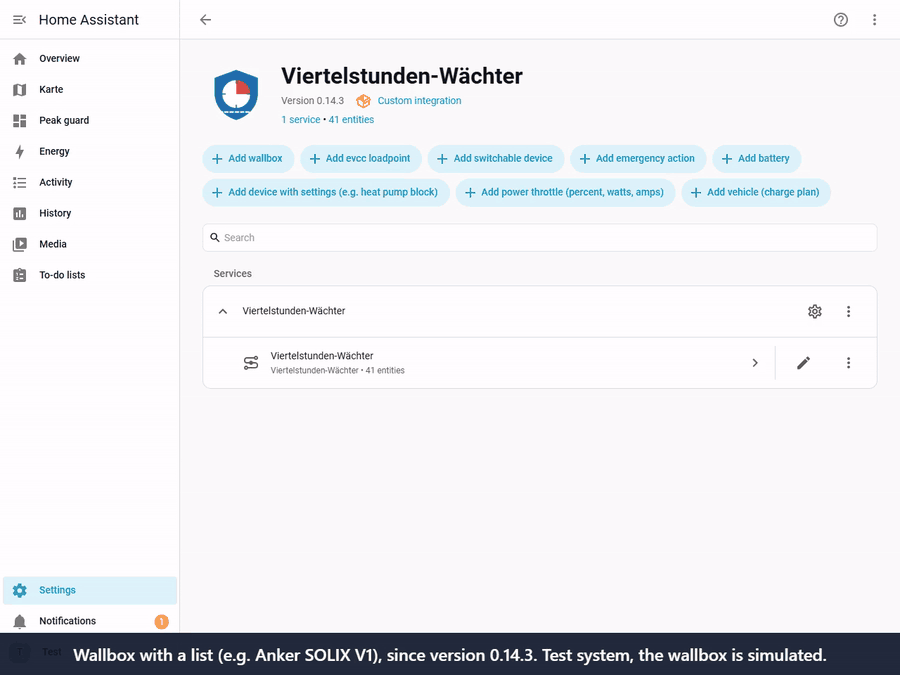
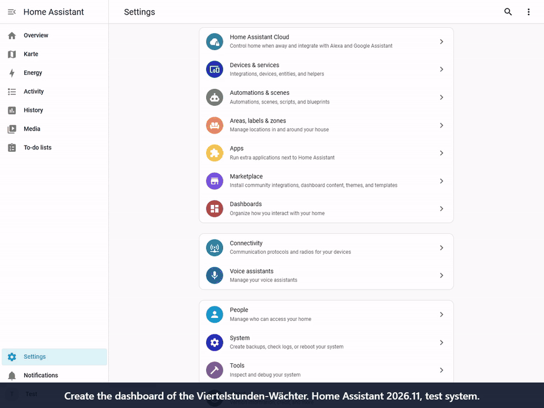

# FAQ (technical)

Questions users really asked, with a short answer. More in the [manual](MANUAL.md).
*Deutsch: [HAEUFIGE_FRAGEN.md](HAEUFIGE_FRAGEN.md)*

## Setting up

**Do I need solar panels?**
No. The guard only needs the grid import. Only the charge plan uses solar, and there it is optional.

**Which sensors do I need?**
1. **Grid import power** (required): in W or kW, with a new value every few seconds. A sensor that goes negative while exporting
   works as well.
2. **Grid import energy counter** (recommended): in Wh or kWh, counts only the import and keeps rising. It keeps the quarter hour
   right after a restart.

**I have no meter of my own, only the grid operator's smart meter.**
Two ways, see [manual, section 1](MANUAL.md):
- A meter in the distribution board, for example a Shelly with current clamps. The easiest start.
- The customer interface of the smart meter with a reading head. The grid operator hands out the key on request.

The grid operator's web portal is not enough: its values arrive the next day.

**Are values every 15 minutes or every hour enough?**
Not for controlling. The guard has to see the *running* quarter hour. A value older than 2 minutes counts as missing: the guard
does not act and shows *no data*. It still shows peaks and costs afterwards.

**My template sensor (e.g. from a Shelly 3EM Pro) is missing from the list.**
Since 0.13.3 any sensor can be chosen. The dialog checks the **unit** (W/kW or Wh/kWh), not the device class.

## In operation

**Mode *Active*, the log says "would lower", but nothing happens.**
Every device has its own switch *Observe only* as well. With it on, the guard never acts on that device.
Since 0.14.2 a hint appears under **Settings > Repairs**, and *Fix* switches it off with one click.
Without the update: at the device, three dots > *Reconfigure* > switch *Observe only* off.

**Can it control my Wattpilot?**
Yes, through the integration `wattpilot-HA` (charging current and phases). Tested on real hardware.
Other wallboxes: see [compatibility](COMPATIBILITY.md).

**My wallbox has the charging current as a list ("6 A", "8 A" …), e.g. Anker SOLIX V1.**
Since 0.14.3 the field *Charging current setting* takes such a list. The guard picks the matching entry, never a higher one, and
lowers step by step. Up to 0.14.2: add it as *device with settings*, value `6 A` (exactly as in the list), *Put the previous
values back* on. Then it lowers to 6 A in one step.

Video (40 s, test system, wallbox simulated; [as MP4](videos/wallbox_with_list_en.mp4)):

**How do I add my battery when I already have my own min-SOC logic (e.g. Victron)?**
Device type *Battery*. *Setting that releases the battery* = the min-SOC entity, value = the low min-SOC (e.g. `10`).
*Put the previous values back* **off**, and your own logic as *Script after taking back* (e.g. "freeze the current SOC as min-SOC").
Switch your own trigger automation off, or two controllers act at once.

**Can it put the heat pump on "standby"?**
Yes, device type *device with settings*: the mode select, value as in the list (e.g. `Standby`). For protection set a *Comfort
sensor* (e.g. hot water), *Minimum duration* and *Pause after taking back*, so the compressor does not cycle.

**I have no wallbox, but a heating element (e.g. 3 phases with 1.5 kW each). Does that work?**
Yes. The guard only needs the grid measurement, a wallbox is not required.
- Phases switchable one by one (three switches): three *switchable devices*, each with its own priority. Then it takes away only
  as much as needed (1.5, 3 or 4.5 kW).
- Power controller with a number (percent or watts): *power throttle*. Then it lowers step by step.
- Switchable only as a whole: one *switchable device*, it then switches all 4.5 kW at once.

Other large loads with a switch in Home Assistant work the same way. It sees the use of a single device only if that device has
its own power sensor. At first let it run a few days in mode *Observe only*: it switches nothing and shows what it would do.

**I see no update.**
Updates come through the Marketplace (HACS) under **Settings > Updates**. It can take a few hours until a new version shows up.

## Dashboard

**How do I add the dashboard?** (administrator account needed)

Video (1 min, Home Assistant 2026.11; [as MP4](videos/create_dashboard_en.mp4)):

*Let the guard build it*
1. **Settings > Tools** (in older versions bottom left **Developer tools**), at the top the tab **Actions**.
2. Type "Create dashboard" in the field *Action*, pick **Viertelstunden-Wächter: Create dashboard**.
3. Bottom right **Perform action**.
4. The response appears below, a long text starting with `views:`. Copy all of it (copy icon or Ctrl+A, Ctrl+C).

*Add an empty dashboard*
1. **Settings > Dashboards**, bottom right **+ Add dashboard**.
2. **New dashboard from scratch**, enter a name (e.g. "Peak guard"), **Create**.
3. Open the new dashboard in the sidebar.

*Paste the text*
1. Top right the **pencil** (edit).
2. Top right **three dots > Raw configuration editor**.
3. Select all (Ctrl+A), delete, paste the copied text (Ctrl+V).
4. **Save**, close with the **X**, **Done**.

The dashboard then has three views: *Overview*, *Today* (for the phone) and *Statistics and forecast*.

**It does not work.**
- **Error when saving, version 0.14.1 or older:** there the response holds the dashboard twice. Update to 0.14.2, or take the text
  from the notification (bell bottom left) without the lines with the three backticks.
- **"Entity … not found":** restart Home Assistant once after the update, then run the action again.
- **Action not in the list:** the guard is not set up yet, or Home Assistant was not restarted after the installation.
- **No "Raw configuration editor" in the menu:** click the pencil first. The menu only exists in edit mode.

## evcc

**evcc can limit the grid import too, e.g. to 10 kW. What is the difference?**
evcc limits the power **at the moment**, and only at its charge points. Billed, however, is the **mean of the quarter hour**.
The guard works with this mean: it evens out short peaks (kettle, oven) without braking the car at once. It can also include any
device in Home Assistant, not only the wallbox.
With only evcc and one wallbox and a fixed limit, evcc is enough. Both work together too: the guard then only sets the ceiling in
evcc.

**The log often says "Grid import: your sensor shows 8.6 kW, evcc shows 4.1 kW", shortly after the other way round. Is something wrong?**
No. The guard always works with the sensor you chose as grid import in it. When the values jump back and forth like this, evcc reads
the grid import from another, delayed source (example from feedback: evcc from the Anker via the cloud, the guard directly from the
grid operator's smart meter). On a load jump one source already shows the new value, the other still the old one.
Fix: set the same meter as grid meter in evcc as in the guard; then both show the same.

## General

**Does the guard need internet or AI?**
No. Everything runs locally.
