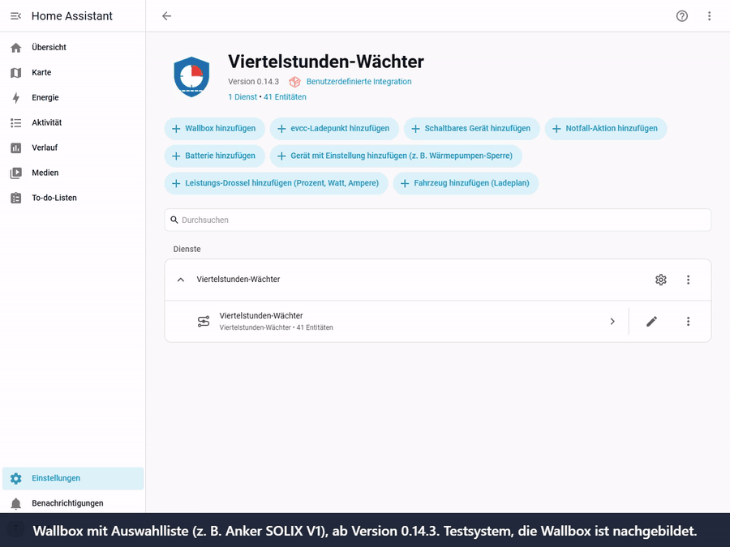
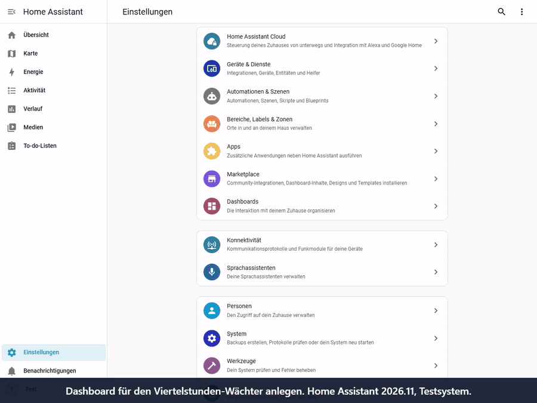

# Häufige Fragen (technisch)

Fragen, die Nutzer wirklich gestellt haben, mit kurzer Antwort. Mehr steht in der [Anleitung](ANLEITUNG.md).
*English: [FAQ.md](FAQ.md)*

## Einrichten

**Brauche ich eine PV-Anlage?**
Nein. Der Wächter braucht nur den Netzbezug. PV nutzt nur der Ladeplan, und dort ist sie optional.

**Welche Sensoren brauche ich?**
1. **Leistung Netzbezug** (Pflicht): in W oder kW, mit neuem Wert alle paar Sekunden. Ein Sensor, der beim Einspeisen negativ
   wird, geht auch.
2. **Zählerstand Netzbezug** (empfohlen): in Wh oder kWh, zählt nur den Bezug und steigt dauernd. Damit stimmt die
   Viertelstunde auch nach einem Neustart.

**Ich habe keinen eigenen Zähler, nur den Smart Meter des Netzbetreibers.**
Zwei Wege, siehe [Anleitung, Abschnitt 1](ANLEITUNG.md#ohne-pv-und-ohne-wechselrichter-zähler):
- Ein Messgerät im Verteiler, zum Beispiel ein Shelly mit Stromwandlern. Das ist der einfachste Start.
- Die Kundenschnittstelle des Smart Meters mit einem Lesekopf. Den Schlüssel dafür gibt der Netzbetreiber auf Anfrage heraus.

Das Webportal des Netzbetreibers reicht nicht: Die Werte kommen erst am nächsten Tag.

**Reichen Werte alle 15 Minuten oder stündlich?**
Nein, zum Regeln nicht. Der Wächter muss die *laufende* Viertelstunde sehen. Ein Wert, der älter als 2 Minuten ist, gilt als fehlend:
Der Wächter greift dann nicht ein und zeigt *keine Daten*. Spitzen und Kosten zeigt er trotzdem im Nachhinein.

**Mein Template-Sensor (z. B. aus einem Shelly 3EM Pro) fehlt in der Auswahl.**
Seit 0.13.3 lässt sich jeder Sensor wählen. Geprüft wird die **Einheit** (W/kW bzw. Wh/kWh), nicht die Geräteklasse.

**Wie richte ich einen Akku mit einstellbarem Mindest-Ladestand ein (ab 0.15)?**
Gilt für jeden Akku, bei dem sich in Home Assistant eine Untergrenze in Prozent einstellen lässt (Mindest-SOC, Entladegrenze,
Reserve). Beispiel mit einem Victron: Normal steht der Mindest-SOC auf 30 %, zum Abfangen einer Spitze soll der Akku bis 15 %
liefern. Beim Gerät *Batterie*:

| Feld | Eintrag |
|---|---|
| Ladestand | der SOC-Sensor des Akkus |
| Einstellung, die die Batterie freigibt / Wert | die Einstellung *ESS Minimum SOC* / `15` |
| Vorherige Werte wiederherstellen | an |
| Mindest-Ladestand folgt dem Ladestand zurück | an: Nach der Spitze geht das Minimum nicht auf einmal auf 30 %, sondern folgt dem Ladestand in den Schritten der Einstellung (beim Victron 5 %: 20, 25, 30), sonst lädt der Victron sofort aus dem Netz |
| Schrittweite Mindest-Ladestand | optional, z. B. `1`: dann 20, 21, 22 …, wenn Ihr Akku jedes ganze Prozent annimmt (einmal von Hand ausprobieren) |
| Nachladen ab | optional, z. B. 22:00: Hat die PV die 30 % bis dahin nicht geschafft, lädt der Akku aus dem Netz nach |
| Einstellung beim Nachladen / Wert | optional, z. B. *ESS maximaler Ladestrom* / `40`: damit langsam geladen wird, danach kommt der alte Wert zurück |
| Einstellung, die die Ladung hält / Wert | optional für die Akku-Reserve vor einer Spitze: *ESS Minimum SOC* / `soc` (bleibt beim aktuellen Ladestand) |

Eigene Automationen fürs Peak-Shaving (Min-SOC bei einer Spitze senken, danach zurückstellen, abends nachladen) braucht es
dann nicht mehr: **deaktivieren** (nicht löschen), sonst stellen zwei an denselben Werten. Die Betriebsart des Wächters muss *Aktiv*
sein, und beim Akku darf *Nur beobachten* nicht an sein. Beim ersten Mal im Protokoll nachsehen, ob alles wie erwartet läuft.

Mehr in der [Anleitung](ANLEITUNG.md), Abschnitt *Akku-Reserve vor einer Spitze*.

## Im Betrieb

**Betriebsart *Aktiv*, das Protokoll sagt „würde drosseln“, aber es passiert nichts.**
Jedes Gerät hat zusätzlich einen eigenen Schalter *Nur beobachten*. Ist er an, greift der Wächter bei diesem Gerät nie ein.
Seit 0.14.2 erscheint dann unter **Einstellungen > Reparaturen** ein Hinweis, und *Reparieren* schaltet es mit einem Klick aus.
Ohne Update: beim Gerät die drei Punkte > *Neu konfigurieren* > *Nur beobachten* aus.

**Ich habe die Grenze auf 4 kW gestellt, aber bei 7 kW greift der Wächter nicht ein.**
Prüfen Sie den Schalter **Bereits erreichte Spitze als Grenze nutzen** (standardmäßig an). Ist die höchste Viertelstunde des Monats schon höher als Ihre
Grenze, gilt für den Rest des Monats diese Spitze statt der Grenze, weil Viertelstunden darunter nichts extra kosten. Bei einer erreichten
Spitze von 9,7 kW regelt der Wächter also gegen 9,7 kW, und 7 kW sind kein Anlass zum Eingreifen. Ab 0.16.0 zeigt das Dashboard unter den Einstellungen die *Wirksame Grenze* mit einem Satz, warum sie höher ist;
im Status-Sensor stehen dazu `effective_limit_kw` und `limit_note`, im Protokoll „Grenze 9.7 kW“. Wollen Sie unabhängig von der Kostenfrage immer unter der eingestellten Grenze bleiben,
schalten Sie *Bereits erreichte Spitze als Grenze nutzen* aus; in diesem Monat spart das dann kein Geld mehr, weil die Spitze schon bezahlt ist.
Weitere Punkte: Eine Wallbox wird nur bis zum Mindeststrom gesenkt und (ohne den Beta-Schalter *Darf als letzte Maßnahme pausiert werden*) nie gestoppt (3-phasig bei 6 A etwa 4,1 kW, 1-phasig etwa 1,4 kW,
2-phasig etwa 2,8 kW). Zum Mithelfen braucht ein Speicher eine eingetragene Freigabe-Einstellung. Und bei *Nur beobachten* am Gerät wird nur
protokolliert (siehe die Frage davor).

**Die Viertelstunden-Prognose zeigt 10,96 kW, aber so viel hatte ich in den letzten 24 Stunden nicht.**
Der Wert ist keine Vorhersage aus der Vergangenheit. Er ist der Durchschnitt der *laufenden* Viertelstunde, wenn die Leistung so bleibt wie jetzt: (bisherige Energie + aktuelle Leistung x Restzeit) / 0,25 h. Eine kurze hohe Last, zum Beispiel Backofen, Wasserkocher oder ein Auto, das gerade zu laden beginnt, lässt ihn kurz springen, und er fällt zurück, sobald die Last endet. Abgerechnet wird nur der Durchschnitt der ganzen Viertelstunde, und den beobachtet der Wächter. Was das Haus üblicherweise braucht, zeigt *Typischer Bezug jetzt (Prognose)*, und die höchste erwartete Viertelstunde der nächsten 24 Stunden zeigen *Erwartete Spitze in 24 h (Prognose)* und die Grafik in der Ansicht *Statistik und Prognose*.

**Der Ladeplan startet und pausiert, stellt aber den Ladestrom nicht ein.**
Richtig, das tut er bisher nicht: Im geplanten Fenster lädt das Auto mit dem, was an der Wallbox eingestellt ist. Den Strom senkt
nur der Wächter, und nur, wenn eine Spitze droht. Der Ladeplan des Wächters ist ein einfacher Planer und bekommt keine neuen
Funktionen mehr. Wann und wie stark das Auto lädt, plant [Plugwhen](https://github.com/mobilewhatelse/plugwhen); dort ist das
Einstellen des Ladestroms geplant.

**Kann er meinen Wattpilot steuern?**
Ja, über die Integration `wattpilot-HA` (Ladestrom und Phasen). Das ist auf echter Hardware getestet.
Andere Wallboxen: siehe [Kompatibilität](KOMPATIBILITAET.md).

**Meine Wallbox hat den Ladestrom als Auswahlliste („6 A“, „8 A“ …), z. B. Anker SOLIX V1.**
Seit 0.14.3 nimmt das Feld *Einstellung Ladestrom* auch eine solche Liste. Der Wächter wählt den passenden Eintrag, nie einen
höheren, und drosselt stufenweise. Bis 0.14.2: als *Gerät mit Einstellung* eintragen, Wert `6 A` (genau wie in der Liste),
*Vorherige Werte wiederherstellen* an. Dann senkt er in einem Schritt auf 6 A.

Video (40 s, Testsystem, Wallbox nachgebildet; [als MP4](videos/wallbox_mit_auswahlliste.mp4)):



**Wie binde ich meinen Speicher ein, wenn ich schon eine eigene Min-SOC-Logik habe (z. B. Victron)?**
**Ab 0.15 brauchen Sie dafür in der Regel kein eigenes Skript:** Für einen Min-SOC in Prozent (Victron ESS und ähnliche) gibt es
*Mindest-Ladestand folgt dem Ladestand zurück* (Min-SOC wird nach der Spitze auf den aktuellen Ladestand gesetzt und folgt ihm bis zum alten Wert),
*Nachladen ab* und *Einstellung, die die Ladung hält* mit dem Wert `soc`; siehe die Frage „Wie richte ich einen Akku mit einstellbarem
Mindest-Ladestand ein (ab 0.15)?“ weiter oben. **Nehmen Sie diesen Weg zuerst.** Das folgende Beispiel mit eigenem Skript ist für Speicher
gedacht, bei denen das nicht passt (kein Prozent-Min-SOC, eigene Sonderlogik). Beides zugleich ergibt Doppelarbeit; im Zweifel das eingebaute
nehmen und das Skript weglassen. **Wichtig:** *Mindest-Ladestand folgt dem Ladestand zurück* und *Nachladen ab* wirken **nur bei
eingeschaltetem *Vorherige Werte wiederherstellen***. Ist es aus (so, wie es für den Weg mit eigenem Skript nötig ist), bleiben beide ohne
Wirkung, und nur das Skript läuft. Mit dem Skript zusammen kann außerdem das Mitziehen abbrechen, wenn das Skript einen anderen Wert setzt als der
Wächter („geändert von jemand anderem“).
Ein erprobtes Beispiel von Markus (Victron, Spitzen unter 4 kW halten; der Min-SOC liegt normalerweise hoch, der Speicher wird nur für Spitzen
freigegeben, danach wird der Min-SOC auf den aktuellen Ladestand eingefroren; bei ihm: *Erwartete Entlastung* 2500 W, *Höchste Dauer* 15 Minuten,
vielen Dank für das Beispiel):
1. **Skript anlegen** (*Einstellungen > Automationen & Szenen > Skripte*, drei Punkte > *In YAML bearbeiten*). Die beiden Entitäten durch Ihre
   ersetzen (Min-SOC-Zahl und Ladestand-Sensor), das Präfix `number.` bzw. `sensor.` nur **einmal**:
   ```yaml
   alias: Min-SOC auf aktuellen Ladestand einfrieren
   sequence:
     - action: number.set_value
       target:
         entity_id: number.victron_settings_ess_batterylife_minimumsoc
       data:
         value: "{{ states('sensor.victron_system_battery_soc') | float(0) | round(0) }}"
   ```
   Einmal mit *Ausführen* testen: Die Min-SOC-Entität muss auf den aktuellen Ladestand springen. Der Wert muss im erlaubten Bereich der Entität liegen.
2. **Gerät *Batterie* im Wächter:** *Ladestand* = Ihr Ladestand-Sensor; *Mindest-Ladestand* z. B. 15 %; *Einstellung, die die Batterie freigibt* = die
   Min-SOC-Entität, *Wert für „freigegeben“* = der niedrige Min-SOC (z. B. `15`); *Vorherige Werte wiederherstellen* **aus**; *Skript nach dem
   Zurücknehmen* = das Skript aus Schritt 1. Ihre eigene Auslöse-Automation abschalten, sonst regeln zwei gleichzeitig.
3. **Zurücknehmen verstehen:** Der Wächter nimmt die Batterie erst zurück (und führt dann das Skript aus), wenn (a) die *Mindestdauer* vorbei ist
   (Standard 5 Minuten) **und** (b) der Spielraum größer ist als die *Erwartete Entlastung*. Der Spielraum kann höchstens **Grenze minus
   Sicherheitsabstand** betragen (4,0 − 0,3 = 3,7 kW). Steht die *Erwartete Entlastung* darüber (z. B. 4000 W), wird die Bedingung **nie** erfüllt,
   und die Batterie bleibt freigegeben, bis der Ladestand unter den Mindest-Ladestand fällt. Tragen Sie daher einen Wert **deutlich unter** der
   Grenze ein, der zu Ihrer üblichen Hauslast passt (z. B. 2500 W), und zusätzlich eine **Höchste Dauer** (z. B. 15 bis 30 Minuten) als Sicherheitsnetz.
4. **Voraussetzungen beim Victron:** Im ESS-Modus *Batterien geladen halten* wird der Min-SOC ignoriert, der Speicher hilft dann nicht. Damit der
   Wächter überhaupt eingreift, muss die wirksame Grenze erreicht sein (siehe die Frage zum Schalter *Bereits erreichte Spitze als Grenze nutzen*).

**Typische Fehler bei der Einrichtung eines Speichers (aus echten Fällen).**
- **Entität im falschen Feld:** Bei *Einstellung beim Nachladen* gehört der **Ladestrom des Speichers** hin (z. B. beim Victron „Ess maxchargecurrent“),
  **nicht** der Ladestrom einer Wallbox (z. B. „Maxcurrent“ des evchargers). Sonst stellt der Wächter zur *Nachladen ab*-Uhrzeit den Strom der Wallbox
  um. Prüfen Sie bei jeder Entität, ob sie wirklich zum Speicher gehört; der Name vor dem Punkt (`number.`, `sensor.`) und die Geräteangabe darunter
  zeigen es.
- **Wert außerhalb des erlaubten Bereichs:** Hat die Entität zum Beispiel einen Bereich von 0 bis 20, kann sie `40` nicht annehmen. Der Bereich steht im
  Entwicklerwerkzeuge-Dialog der Entität und im Fehlerbericht.
- **Nachladen nicht nötig:** Beim Ablauf „Min-SOC einfrieren“ (siehe oben) lassen Sie *Nachladen ab*, *Einstellung beim Nachladen* und *Wert beim
  Nachladen* **leer** (mit dem X löschen). Das Nachladen ist nur für den Fall gedacht, dass der Speicher abends aus dem Netz nachladen soll.
- **Entität doppelt eingetragen:** Beim Einfügen in YAML das Präfix (`number.`, `sensor.`) nur einmal schreiben; ein Rest einer Klammer oder Zeile am
  Ende macht den Editor rot.
- **Sensor mit `_2` am Ende:** Gibt es zwei Ladestand-Sensoren (z. B. aus zwei Victron-Integrationen), prüfen Sie, welcher aktuell ist.
- **Eingebauter Weg und eigenes Skript zugleich:** Nutzen Sie *Mindest-Ladestand folgt dem Ladestand zurück* (mit *Vorherige Werte wiederherstellen* **an**),
  lassen Sie *Skript nach dem Zurücknehmen* **leer**. Das Skript läuft sonst nach dem Wächter und kann das Mitziehen abbrechen, wenn es einen anderen
  Wert setzt. Nutzen Sie dagegen das Skript, schalten Sie *Vorherige Werte wiederherstellen*, *folgt zurück* und *Nachladen* aus.
- **Das Nachladen passiert nicht „jeden Abend um 20 Uhr“:** Es gehört zum Mitziehen nach einer **echten Freigabe**. Erst wenn der Wächter den Speicher bei
  einer Spitze freigegeben und wieder zurückgenommen hat, wird bis zum **alten Wert** nachgeladen, ab der Uhrzeit *Nachladen ab* und bis zu 12 Stunden
  danach. Ohne vorherigen Eingriff passiert zur Uhrzeit nichts. Der **alte Wert ist der, der beim Freigeben in der Min-SOC-Entität stand**: Hat zuvor ein
  eigenes Skript den Min-SOC auf den Ladestand gesetzt (z. B. 21), ist 21 der alte Wert, und es gibt nichts auf 30 % nachzuladen. Stellen Sie den
  Min-SOC einmal von Hand auf Ihren normalen Wert (z. B. 30), bevor der Eingriff kommt. Wird die Integration mitten im Eingriff neu geladen (z. B. beim
  Ändern der Einstellungen), wird alles sofort zurückgegeben und das Mitziehen beginnt nicht. Im Fehlerbericht steht unter *Verlauf* „… freigegeben (…,
  Ladestand 30 %)“ und „Alles freigegeben: Integration beendet“.
- **Nachladen zählt als Last:** Lädt der Speicher abends aus dem Netz nach (z. B. 40 A bei etwa 52 V, grob 2 kW), erscheint das als Netzbezug und zählt
  für die Grenze mit. Für eine sichere Grenze einen kleineren Wert (z. B. 20 A) oder eine spätere Uhrzeit wählen.
- **Restwerte in nicht benutzten Feldern:** Ein *Wert, der die Ladung hält* ohne gewählte *Einstellung, die die Ladung hält* wird nicht benutzt (am besten
  löschen); für „bleibt beim aktuellen Ladestand“ gehört dort `soc` hinein, und es braucht den Schalter *Akku-Reserve vor einer Spitze*.
- **Leistung des Akkus** (optional) dient nur dem Geräte-Check (wie viel der Akku speichert), nicht der Steuerung.
- **Die Grenze greift nicht:** Prüfen Sie *Bereits erreichte Spitze als Grenze nutzen* (siehe die Frage dazu): Liegt die Monatsspitze über Ihrer Grenze, rechnet der
  Wächter damit.

**Wie prüfe ich, ob die Einrichtung des Speichers funktioniert (Testablauf und Fehlerbericht lesen)?**
1. **Vorher einstellen:** Min-SOC auf den **normalen Wert** (z. B. 30), *Vorherige Werte wiederherstellen* an, *Mindest-Ladestand folgt dem Ladestand zurück* an,
   *Nachladen ab* (z. B. 20:00) mit der **Ladestrom-Entität des Speichers** (Victron: „Ess maxchargecurrent“) und einem Wert im erlaubten Bereich, *Skript
   nach dem Zurücknehmen* leer. Danach **nichts mehr an den Einstellungen des Wächters ändern**: Jede Änderung lädt die Integration neu und gibt laufende
   Eingriffe sofort zurück (im Verlauf: „Alles freigegeben: Integration beendet“).
2. **Einen Eingriff auslösen:** warten, bis es eine echte Spitze gibt, oder die Grenze kurz sehr niedrig stellen (z. B. 0,5 kW), bis im Protokoll
   „… freigegeben (… zu viel, Ladestand 30 %)“ steht, und dann die Grenze **zurückstellen**.
3. **Erwartete Zeilen im Verlauf:** Freigabe, Rücknahme, dann „Mindest-Ladestand folgt …“ (der Min-SOC steht auf dem Ladestand und steigt Schritt für Schritt
   bis zum alten Wert) und ab der Uhrzeit *Nachladen ab* (bis 12 Stunden danach) „Nachladen …“: Der Min-SOC geht auf den alten Wert, die Ladestrom-Entität auf den
   eingetragenen Wert, am Ende kommt beides zurück. Ohne vorherige Freigabe passiert zur Uhrzeit nichts.
4. **Fehlerbericht lesen:** Dashboard, Taste *Fehlerbericht senden* (enthält keine Namen und Adressen). Wichtig sind `werte.limit_kw` (die wirksame Grenze), bei
   den Geräten `eingriff_aktiv` und `nur_beobachten`, und die Zeilen unter *Verlauf* (neueste zuerst, mit „vor x Stunden“). Typische Zeilen: „Wallbox 16 A -> 8 A“
   (gesenkt), „… freigegeben (…)“ (Speicher freigegeben), „… wieder 16 A“ / „… wieder wie vorher“ (zurückgegeben), „Alles freigegeben: Integration beendet“
   (Neuladen, z. B. nach Änderungen), „Nur beobachten: … würde …“ (am Gerät ist *Nur beobachten* an).
5. **Bereiche prüfen:** Der Wert beim Nachladen muss im erlaubten Bereich der Entität liegen (Victron „Ess maxchargecurrent“: z. B. −100 bis 100 in Schritten von 10;
   die Maxcurrent-Entität einer Wallbox hat einen anderen Bereich und gehört dort nicht hin).

**Kann er die Wärmepumpe auf „Bereitschaft“ stellen?**
Ja, Gerätetyp *Gerät mit Einstellung*: die Modus-Auswahl, Wert `Bereitschaft`. Zum Schutz *Komfort-Sensor* (z. B. Warmwasser),
*Mindestdauer* und *Pause nach dem Zurücknehmen* setzen, damit der Verdichter nicht taktet.

**Ich habe keine Wallbox, aber eine Heizpatrone (z. B. 3 Phasen mit je 1,5 kW). Geht das?**
Ja. Der Wächter braucht nur die Netzmessung, eine Wallbox ist nicht nötig.
- Phasen einzeln schaltbar (drei Schalter): drei *Schaltbare Geräte* mit eigener Priorität. Dann nimmt er nur so viel weg wie
  nötig (1,5, 3 oder 4,5 kW).
- Leistungssteller mit Zahlenwert (Prozent oder Watt): *Leistung drosseln*. Dann regelt er stufenweise.
- Nur als Ganzes schaltbar: ein *Schaltbares Gerät*, er schaltet dann alle 4,5 kW auf einmal.

Andere Großverbraucher mit einem Schalter in Home Assistant gehen genauso. Den Verbrauch eines einzelnen Geräts sieht er nur mit
einem eigenen Leistungssensor. Am Anfang ein paar Tage in der Betriebsart *Nur beobachten* laufen lassen: Er schaltet nichts und zeigt, was er
tun würde.

**Ich sehe kein Update.**
Updates kommen über den Marketplace (HACS) unter **Einstellungen > Updates**. Bis eine neue Version dort auftaucht, kann es ein paar
Stunden dauern.

**Warum komme ich trotz Wächter über die Grenze?**
Der Wächter kann nur senken, was er steuern darf, und nur so schnell, wie die Geräte und ihre Messwerte reagieren. Die häufigsten
Gründe: Es läuft mehr, als sich abschalten oder drosseln lässt (Herd, Backofen, Wärmepumpe ohne Eintrag). Ein Gerät steht auf
*Nur beobachten*. Eine Wallbox ist schon am Mindeststrom. Ein Befehl kommt spät an oder der Leistungswert des Geräts kommt über
eine Cloud nur alle paar Minuten. Oder der Abstand zur Grenze ist für die Anlage zu klein eingestellt. Im Protokoll *Letzte
Eingriffe* steht, was der Wächter versucht hat und was nicht umgesetzt wurde. Auch mit eingerichteter Wallbox kann es passieren, wenn
der Rest des Hauses allein schon nahe an der Grenze liegt: die Wallbox lässt sich nur bis zu ihrem Mindeststrom senken. Passiert es
regelmäßig und der Grund ist unklar, hilft die Taste *Rückmeldung senden* (mit Kontaktadresse, wenn Sie eine Antwort möchten).

**Kann der Wächter die Wallbox ganz ausschalten, wenn das Senken des Ladestroms nicht mehr reicht?**
Ab 0.16.0 als **Beta, standardmäßig aus**: Schalter **Darf als letzte Maßnahme pausiert werden (Beta)** beim Gerät *Wallbox* oder *evcc-Ladepunkt*.
Solange er aus ist, wird eine Wallbox wie bisher nur **bis zum Mindeststrom gesenkt und nie gestoppt**. Ist er an, pausiert der Wächter das Laden nur, wenn
(1) die Wallbox schon mit dem Mindeststrom lädt (dreiphasig mit erlaubter Umschaltung erst nach dem Wechsel auf 1 Phase), (2) alle anderen Geräte
ausgeschöpft sind (Schalter, Speicher, Einstellungen, Drosseln) und (3) das 2 Minuten lang so bleibt (bei evcc nur, wenn der Modus bekannt ist). Wie: bei evcc wird der Modus auf *Aus* gestellt und
der Modus von vorher gemerkt (auch über einen Neustart); bei einer anderen Wallbox braucht es einen **Befehl zum Pausieren** und einen **zum Erlauben**
(Knopf, Schalter, Auswahl oder Zahl, wie beim Ladeplan). Zurück geht es **als Erstes** (umgekehrte Reihenfolge), wenn der Spielraum für den Mindeststrom
plus 0,5 kW reicht, frühestens nach der *Mindestdauer einer Pause* (0 = 5 Minuten); danach keine neue Pause vor Ablauf der *Pause nach dem Zurücknehmen*
(0 = 5 Minuten). Beim Neuladen, Neustart, Wechsel auf *Nur beobachten* oder *Aus* und beim Ausschalten des Schalters wird sofort wieder erlaubt. Hat
jemand den evcc-Modus (oder den Pausieren-Schalter) inzwischen selbst geändert, bleibt es dabei, und der Wächter pausiert diese Wallbox eine Stunde lang
nicht. Jede Pause kommt als Meldung (bei *Meldung bei Eingriff*), zählt als Eingriff, steht im Protokoll („… pausiert (… kW zu viel, Mindeststrom reicht
nicht …)“, „… wieder erlaubt“), im Fehlerbericht (`eingriff_aktiv`, `pausiert`) und im Dashboard („Wallbox vom Wächter pausiert“, Attribut
`paused_by_guard` am Status-Sensor, z. B. für Plugwhen). **Wichtig:** Nicht jedes Auto und nicht jede Wallbox lädt nach einer Pause von selbst weiter
(manchmal muss der Stecker neu gesteckt werden). Deshalb vorher mit **Nur beobachten** testen (dann steht nur „würde pausiert“ im Protokoll, gesendet
wird nichts) und am eigenen Auto ausprobieren.
Die bisherige Lösung geht weiterhin, z. B. wenn Sie mehr als Pausieren brauchen (oder ohne den Schalter): ein eigenes Gerät vom Typ **Skript** (Notfall-Aktion) mit zwei kleinen Skripten, *Skript: eingreifen*
(z. B. evcc-Modus auf *Aus* oder die Wallbox pausieren) und *Skript nach dem Zurücknehmen* (den alten Modus wieder setzen), und der **niedrigsten
Priorität** (10 = nur, wenn sonst nichts hilft). Der Wächter löst es erst aus, wenn Wallbox, Speicher und die anderen Geräte nicht ausreichen, und gibt es
in umgekehrter Reihenfolge zuerst zurück. Beachten: Ein gestoppter Ladevorgang startet je nach Auto und Wallbox nicht immer von selbst wieder; im Zweifel
vorher am eigenen Auto ausprobieren und *Nur beobachten* nutzen.

**Nach dem Nachladen steht der maximale Ladestrom (z. B. Ess maxchargecurrent) noch auf dem Nachladewert (z. B. 40 A) statt wieder auf dem alten Wert.**
In 0.15.0 passiert das, wenn der Mindest-Ladestand **während des Nachladens von Hand** geändert wird: Der Wächter beendet dann das Mitziehen („anders
eingestellt“), stellte aber den Ladestrom nicht zurück. **Ab 0.15.1 ist das behoben** (der Strom geht zurück, wenn er noch den Wert hat, den der Wächter
gesetzt hat). Bis dahin: den Ladestrom von Hand zurückstellen und den Mindest-Ladestand während des Nachladens nicht ändern.

**Ich bekomme keine Meldung bei Eingriff, obwohl der Schalter an ist.**
Die Meldung geht über die **Benachrichtigungsdienste in den allgemeinen Einstellungen** des Wächters (Zahnrad der Integration, z. B. `notify.mobile_app_handy`).
Ohne eingetragenen Dienst wird nichts gesendet; der Schalter allein reicht nicht. Im Beobachtungsmodus und bei *Nur beobachten* am Gerät kommt ebenfalls keine
Meldung. Gesendet wird beim **ersten echten Eingriff** (höchstens alle 30 Minuten) und als **Zusammenfassung**, wenn alles wieder freigegeben ist.

**Was ändert die Strategie (*Strenge Reihenfolge* oder *Geringster Komfortverlust*)?**
*Strenge Reihenfolge* arbeitet wie eine feste Liste: erst Priorität 1 ganz ausreizen, dann 2, dann 3. *Geringster Komfortverlust* nimmt die günstigste Kombination
(Summe der Prioritäten), die reicht. Beispiel: 0,7 kW zu viel, Pool Priorität 1, Wallbox 3: nur der Pool geht aus, das Auto lädt weiter. Es macht nur einen
Unterschied, wenn mehrere Geräte nötig wären; für das Nachladen und die Freigabe eines Speichers ändert es nichts.

**Beim Speicher mit Nachladen: Der Ladestrom bleibt auf dem Nachladewert (z. B. 30 A). Was ist bei Sonne? Lädt der Speicher bei kleiner Abweichung nicht sofort nach?**
Solange das Nachladen läuft, ist der maximale Ladestrom des Speichers auf den **Nachladewert** begrenzt, **auch wenn die Sonne scheint**. Erreicht der Ladestand den alten
Mindest-Ladestand (z. B. 30 %), stellt der Wächter den Strom auf den alten Wert (z. B. 70 A) zurück. Bei einem Abstand von nur 2 % ist das nach kurzer Zeit. **Ob** der
Speicher sofort aus dem Netz nachlädt, wenn der Mindest-Ladestand wieder höher steht als der Ladestand, entscheidet der **Wechselrichter** (bei Victron der ESS-Modus
und BatteryLife, z. B. der Zustand *Sustain*), nicht der Wächter. Der Wächter setzt nur den Min-SOC und den Ladestrom; die Werte stehen im Fehlerbericht
(`mindest_ladestand_folgt`).

**Welchen Leistungssensor trage ich bei der Wallbox ein?**
Möglichst einen, der direkt von der Wallbox kommt und die **gesamte** Ladeleistung zeigt, nicht nur eine Phase (L1) und nicht den
Wert aus der Cloud des Autos. Ein Sensor für nur eine Phase zeigt bei dreiphasigem Laden ein Drittel; ein Wert, der über eine
Cloud nur alle paar Minuten kommt, lässt den Wächter zu spät sehen, ob ein Befehl gewirkt hat.

**Eine Viertelstunde ist falsch verbucht (z. B. eine Spitze, die es nie gab). Wie korrigiere ich das?**
Mit der Aktion `viertelstunden_waechter.correct_quarter` unter **Entwicklerwerkzeuge > Aktionen** (nur Administratoren):
*Beginn* ist der Anfang der Viertelstunde in Ortszeit, z. B. `2026-11-16T06:15`. Mit einem *Wert* (kW laut Zähler) wird sie
ersetzt; **ohne Wert wird sie aus der Aufzeichnung genommen** (wenn der richtige Wert nicht bekannt ist). Die Spitze des Tages
und des Monats wird neu berechnet, im Protokoll steht eine Zeile, und der CSV-Export enthält danach den neuen Stand.
Ab 0.15 erkennt der Wächter den häufigsten Auslöser selbst: Stand der Bezugszähler länger als eine Viertelstunde still (Zähler
oder Verbindung weg) und bringt dann alles auf einmal, wird diese Viertelstunde nicht als Spitze verbucht.

## Dashboard

**Wie lege ich das Dashboard an?** (Administrator-Konto nötig)

Video (1 Min., Home Assistant 2026.11; [als MP4](videos/dashboard_anlegen.mp4)):



*Dashboard erzeugen lassen*
1. **Einstellungen > Werkzeuge** (in älteren Versionen links unten **Entwicklerwerkzeuge**), oben den Reiter **Aktionen**.
2. Im Feld *Aktion* „Dashboard erstellen“ tippen, **Viertelstunden-Wächter: Dashboard erstellen** wählen.
3. Unten rechts **Aktion ausführen**.
4. Darunter erscheint die Antwort, ein langer Text, der mit `views:` beginnt. Alles kopieren (Kopier-Symbol oder Strg+A, Strg+C).

*Leeres Dashboard anlegen*
1. **Einstellungen > Dashboards**, unten rechts **+ Dashboard hinzufügen**.
2. **Neues Dashboard von Grund auf**, Namen eingeben (z. B. „Spitzenwächter“), **Erstellen**.
3. Das neue Dashboard in der Seitenleiste öffnen.

*Text einfügen*
1. Oben rechts auf den **Stift** (Bearbeiten).
2. Oben rechts **drei Punkte > Raw-Konfigurationseditor**.
3. Alles markieren (Strg+A), löschen, den kopierten Text einfügen (Strg+V).
4. **Speichern**, mit dem **X** schließen, **Fertig**.

Danach hat das Dashboard drei Ansichten: *Übersicht*, *Heute* (fürs Handy) und *Statistik und Prognose*.

**Es klappt nicht.**
- **Fehler beim Speichern, Version 0.14.1 oder älter:** Dort enthält die Antwort das Dashboard zweimal. Auf 0.14.2 aktualisieren,
  oder den Text aus der Benachrichtigung (Glocke links unten) nehmen, ohne die Zeilen mit den drei Backticks.
- **„Entity … not found“:** Home Assistant nach dem Update einmal neu starten, dann die Aktion noch einmal ausführen.
- **Aktion nicht in der Liste:** Der Wächter ist noch nicht eingerichtet, oder Home Assistant wurde nach der Installation nicht
  neu gestartet.
- **Kein „Raw-Konfigurationseditor“ im Menü:** Erst auf den Stift klicken. Das Menü gibt es nur im Bearbeiten-Modus.

## evcc

**evcc kann den Netzbezug auch auf z. B. 10 kW begrenzen. Was ist der Unterschied?**
evcc begrenzt die Leistung **im Moment**, und nur an seinen Ladepunkten. Abgerechnet wird aber der **Mittelwert der Viertelstunde**.
Der Wächter rechnet mit diesem Mittelwert: Kurze Spitzen (Wasserkocher, Backrohr) gleicht er aus, ohne gleich das Auto zu bremsen.
Er kann außerdem jedes Gerät in Home Assistant einbeziehen, nicht nur die Wallbox.
Wer nur evcc und eine Wallbox hat und eine feste Grenze will, kommt mit evcc aus. Beides geht auch zusammen: Der Wächter setzt dann nur
die Obergrenze in evcc.

**Im Protokoll steht oft „Netzbezug: Ihr Sensor zeigt 8,6 kW, evcc zeigt 4,1 kW“, kurz darauf umgekehrt. Ist etwas falsch?**
Nein. Der Wächter regelt immer mit dem Sensor, den Sie bei ihm als Netzbezug gewählt haben. Springen die Werte so hin und her, liest
evcc den Netzbezug aus einer anderen, verzögerten Quelle (Beispiel aus einer Rückmeldung: evcc vom Anker über die Cloud, der Wächter
direkt vom Smartmeter des Netzbetreibers). Bei Lastsprüngen zeigt dann eine Quelle schon den neuen Wert, die andere noch den alten.
Abhilfe: in evcc denselben Zähler als Netzzähler einstellen wie im Wächter; dann zeigen beide dasselbe.

## Allgemein

**Kann ich den Wächter für einen zweiten Zählpunkt (zweites Haus) doppelt laufen lassen?**
Noch nicht. Der Wächter erlaubt einen Eintrag je Home Assistant, und seine Dienste sprechen immer diesen einen an. Für einen zweiten Zählpunkt: entweder weglassen, oder, wenn beide gemeinsam abgerechnet werden (eine Spitze für beide), die beiden Leistungen in einem Template-Sensor addieren und diesen als Netzleistung eintragen. Mehrere Zählpunkte sind für eine spätere Version geplant (etwa Februar 2027, keine Zusage).

**Braucht der Wächter Internet oder KI?**
Nein. Alles läuft lokal.
