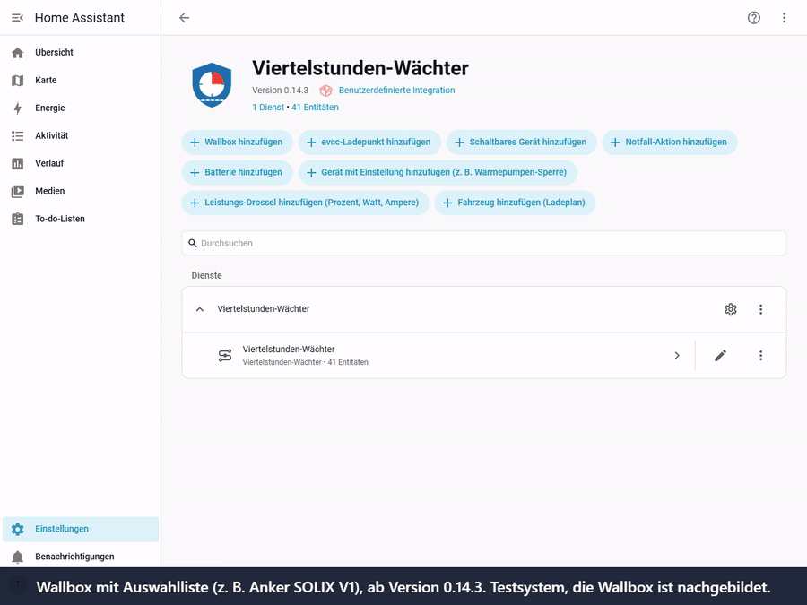
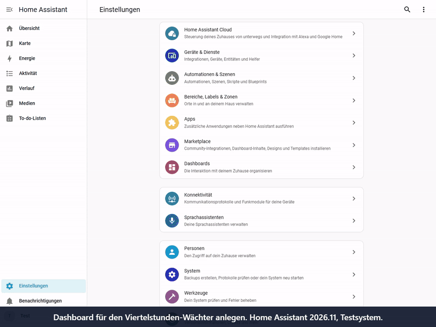

# Häufige Fragen (technisch)

Fragen, die Nutzer wirklich gestellt haben, mit kurzer Antwort. Mehr steht in der [Anleitung](ANLEITUNG.md).
*English: [FAQ.md](FAQ.md)*

## Einrichten

**Brauche ich eine PV-Anlage?**
Nein. Der Wächter braucht nur den Netzbezug. PV nutzt nur der Ladeplan, und dort ist sie optional.

**Welche Sensoren brauche ich?**
1. **Leistung Netzbezug** (Pflicht): in W oder kW, mit neuem Wert alle paar Sekunden. Ein Sensor, der beim Einspeisen negativ
   wird, geht auch.
2. **Zählerstand Netzbezug** (empfohlen): in Wh oder kWh, zählt nur den Bezug und steigt dauernd. Damit stimmt die
   Viertelstunde auch nach einem Neustart.

**Ich habe keinen eigenen Zähler, nur den Smart Meter des Netzbetreibers.**
Zwei Wege, siehe [Anleitung, Abschnitt 1](ANLEITUNG.md#ohne-pv-und-ohne-wechselrichter-zähler):
- Ein Messgerät im Verteiler, zum Beispiel ein Shelly mit Stromwandlern. Das ist der einfachste Start.
- Die Kundenschnittstelle des Smart Meters mit einem Lesekopf. Den Schlüssel dafür gibt der Netzbetreiber auf Anfrage heraus.

Das Webportal des Netzbetreibers reicht nicht: Die Werte kommen erst am nächsten Tag.

**Reichen Werte alle 15 Minuten oder stündlich?**
Nein, zum Regeln nicht. Der Wächter muss die *laufende* Viertelstunde sehen. Ein Wert, der älter als 2 Minuten ist, gilt als fehlend:
Der Wächter greift dann nicht ein und zeigt *keine Daten*. Spitzen und Kosten zeigt er trotzdem im Nachhinein.

**Mein Template-Sensor (z. B. aus einem Shelly 3EM Pro) fehlt in der Auswahl.**
Seit 0.13.3 lässt sich jeder Sensor wählen. Geprüft wird die **Einheit** (W/kW bzw. Wh/kWh), nicht die Geräteklasse.

## Im Betrieb

**Betriebsart *Aktiv*, das Protokoll sagt „würde drosseln“, aber es passiert nichts.**
Jedes Gerät hat zusätzlich einen eigenen Schalter *Nur beobachten*. Ist er an, greift der Wächter bei diesem Gerät nie ein.
Seit 0.14.2 erscheint dann unter **Einstellungen > Reparaturen** ein Hinweis, und *Reparieren* schaltet es mit einem Klick aus.
Ohne Update: beim Gerät die drei Punkte > *Neu konfigurieren* > *Nur beobachten* aus.

**Kann er meinen Wattpilot steuern?**
Ja, über die Integration `wattpilot-HA` (Ladestrom und Phasen). Das ist auf echter Hardware getestet.
Andere Wallboxen: siehe [Kompatibilität](KOMPATIBILITAET.md).

**Meine Wallbox hat den Ladestrom als Auswahlliste („6 A“, „8 A“ …), z. B. Anker SOLIX V1.**
Seit 0.14.3 nimmt das Feld *Einstellung Ladestrom* auch eine solche Liste. Der Wächter wählt den passenden Eintrag, nie einen
höheren, und drosselt stufenweise. Bis 0.14.2: als *Gerät mit Einstellung* eintragen, Wert `6 A` (genau wie in der Liste),
*Vorherige Werte wiederherstellen* an. Dann senkt er in einem Schritt auf 6 A.

Video (40 s, Testsystem, Wallbox nachgebildet; [als MP4](videos/wallbox_mit_auswahlliste.mp4)):

**Wie binde ich meinen Speicher ein, wenn ich schon eine eigene Min-SOC-Logik habe (z. B. Victron)?**
Gerätetyp *Batterie*. *Einstellung, die die Batterie freigibt* = die Min-SOC-Entität, Wert = der niedrige Min-SOC (z. B. `10`).
*Vorherige Werte wiederherstellen* **aus** und die eigene Logik als *Skript nach dem Zurücknehmen* eintragen (z. B. „aktuellen SOC als
Min-SOC einfrieren“). Die eigene Auslöse-Automation abschalten, sonst regeln zwei gleichzeitig.

**Kann er die Wärmepumpe auf „Bereitschaft“ stellen?**
Ja, Gerätetyp *Gerät mit Einstellung*: die Modus-Auswahl, Wert `Bereitschaft`. Zum Schutz *Komfort-Sensor* (z. B. Warmwasser),
*Mindestdauer* und *Pause nach dem Zurücknehmen* setzen, damit der Verdichter nicht taktet.

**Ich habe keine Wallbox, aber eine Heizpatrone (z. B. 3 Phasen mit je 1,5 kW). Geht das?**
Ja. Der Wächter braucht nur die Netzmessung, eine Wallbox ist nicht nötig.
- Phasen einzeln schaltbar (drei Schalter): drei *Schaltbare Geräte* mit eigener Priorität. Dann nimmt er nur so viel weg wie
  nötig (1,5, 3 oder 4,5 kW).
- Leistungssteller mit Zahlenwert (Prozent oder Watt): *Leistung drosseln*. Dann regelt er stufenweise.
- Nur als Ganzes schaltbar: ein *Schaltbares Gerät*, er schaltet dann alle 4,5 kW auf einmal.

Andere Großverbraucher mit einem Schalter in Home Assistant gehen genauso. Den Verbrauch eines einzelnen Geräts sieht er nur mit
einem eigenen Leistungssensor. Am Anfang ein paar Tage in der Betriebsart *Nur beobachten* laufen lassen: Er schaltet nichts und zeigt, was er
tun würde.

**Ich sehe kein Update.**
Updates kommen über den Marketplace (HACS) unter **Einstellungen > Updates**. Bis eine neue Version dort auftaucht, kann es ein paar
Stunden dauern.

## Dashboard

**Wie lege ich das Dashboard an?** (Administrator-Konto nötig)

Video (1 Min., Home Assistant 2026.11; [als MP4](videos/dashboard_anlegen.mp4)):

*Dashboard erzeugen lassen*
1. **Einstellungen > Werkzeuge** (in älteren Versionen links unten **Entwicklerwerkzeuge**), oben den Reiter **Aktionen**.
2. Im Feld *Aktion* „Dashboard erstellen“ tippen, **Viertelstunden-Wächter: Dashboard erstellen** wählen.
3. Unten rechts **Aktion ausführen**.
4. Darunter erscheint die Antwort, ein langer Text, der mit `views:` beginnt. Alles kopieren (Kopier-Symbol oder Strg+A, Strg+C).

*Leeres Dashboard anlegen*
1. **Einstellungen > Dashboards**, unten rechts **+ Dashboard hinzufügen**.
2. **Neues Dashboard von Grund auf**, Namen eingeben (z. B. „Spitzenwächter“), **Erstellen**.
3. Das neue Dashboard in der Seitenleiste öffnen.

*Text einfügen*
1. Oben rechts auf den **Stift** (Bearbeiten).
2. Oben rechts **drei Punkte > Raw-Konfigurationseditor**.
3. Alles markieren (Strg+A), löschen, den kopierten Text einfügen (Strg+V).
4. **Speichern**, mit dem **X** schließen, **Fertig**.

Danach hat das Dashboard drei Ansichten: *Übersicht*, *Heute* (fürs Handy) und *Statistik und Prognose*.

**Es klappt nicht.**
- **Fehler beim Speichern, Version 0.14.1 oder älter:** Dort enthält die Antwort das Dashboard zweimal. Auf 0.14.2 aktualisieren,
  oder den Text aus der Benachrichtigung (Glocke links unten) nehmen, ohne die Zeilen mit den drei Backticks.
- **„Entity … not found“:** Home Assistant nach dem Update einmal neu starten, dann die Aktion noch einmal ausführen.
- **Aktion nicht in der Liste:** Der Wächter ist noch nicht eingerichtet, oder Home Assistant wurde nach der Installation nicht
  neu gestartet.
- **Kein „Raw-Konfigurationseditor“ im Menü:** Erst auf den Stift klicken. Das Menü gibt es nur im Bearbeiten-Modus.

## evcc

**evcc kann den Netzbezug auch auf z. B. 10 kW begrenzen. Was ist der Unterschied?**
evcc begrenzt die Leistung **im Moment**, und nur an seinen Ladepunkten. Abgerechnet wird aber der **Mittelwert der Viertelstunde**.
Der Wächter rechnet mit diesem Mittelwert: Kurze Spitzen (Wasserkocher, Backrohr) gleicht er aus, ohne gleich das Auto zu bremsen.
Er kann außerdem jedes Gerät in Home Assistant einbeziehen, nicht nur die Wallbox.
Wer nur evcc und eine Wallbox hat und eine feste Grenze will, kommt mit evcc aus. Beides geht auch zusammen: Der Wächter setzt dann nur
die Obergrenze in evcc.

**Im Protokoll steht oft „Netzbezug: Ihr Sensor zeigt 8,6 kW, evcc zeigt 4,1 kW“, kurz darauf umgekehrt. Ist etwas falsch?**
Nein. Der Wächter regelt immer mit dem Sensor, den Sie bei ihm als Netzbezug gewählt haben. Springen die Werte so hin und her, liest
evcc den Netzbezug aus einer anderen, verzögerten Quelle (Beispiel aus einer Rückmeldung: evcc vom Anker über die Cloud, der Wächter
direkt vom Smartmeter des Netzbetreibers). Bei Lastsprüngen zeigt dann eine Quelle schon den neuen Wert, die andere noch den alten.
Abhilfe: in evcc denselben Zähler als Netzzähler einstellen wie im Wächter; dann zeigen beide dasselbe.

## Allgemein

**Braucht der Wächter Internet oder KI?**
Nein. Alles läuft lokal.
